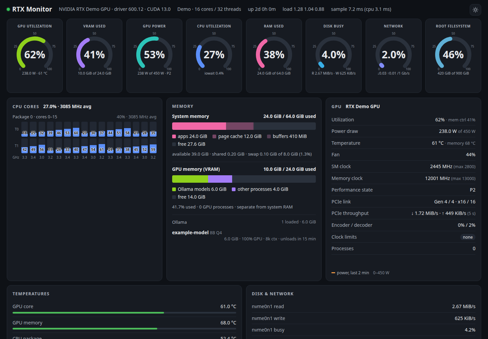

<h1 align="center">RTX-Monitor</h1>

<p align="center"><strong>Live resource telemetry with a small footprint.</strong></p>

## Features

- GPU load, memory, temperature and utilization through NVIDIA NVML.
- CPU, RAM, disk, network and process information from Linux procfs/sysfs.
- A dependency-free page receives live samples over Server-Sent Events, with optional Ollama model details.



*Dashboard rendered from fabricated telemetry; the screenshot contains no real hostname, process list or device identifier.*

## At a glance

| Area | Details |
|---|---|
| Runtime | Python 3 standard library |
| Interface | Dependency-free HTML/JavaScript + Server-Sent Events |
| GPU source | NVIDIA NVML via `ctypes` |
| System source | Linux `/proc` and `/sys` |
| Default ports | HTTP 8888 · HTTPS 18888 |

## Stack and architecture

Python 3 standard library, ctypes bindings to `libnvidia-ml.so.1`, Linux `/proc` and `/sys`, and a standalone HTML/JavaScript dashboard. `server.py` collects samples and serves HTTP/SSE; `index.html` renders the stream.


## Repository map

| Path | Responsibility |
|---|---|
| `server.py` | Collectors, NVML bindings, HTTP server and SSE stream |
| `index.html` | Live dashboard, gauges, charts and process tables |
| `rtx-monitor.service` | Portable user-service template |
| `CHECKS.md` | Recorded syntax/CLI validation and hardware-test boundaries |

## Installation and quick start

Run these commands in a **new, separate checkout**. They are not instructions to modify the original running deployment.

```bash
python3 server.py --host 127.0.0.1 --port 8888 --interval 1
```

Open **http://127.0.0.1:8888**. `--interval` sets sample frequency and `--ollama` selects a local Ollama endpoint. `python3 server.py --once` prints one telemetry sample; its output may contain private process information, so do not commit that output.


## Configuration reference

| Setting | Example | Purpose |
|---|---|---|
| `--host` | `127.0.0.1` | Bind locally unless process details should be shared |
| `--port` | `8888` | HTTP listener |
| `--interval` | `1` | Telemetry sample interval in seconds |
| `--ollama` | `http://127.0.0.1:11434` | Optional local Ollama endpoint |
| `--once` | n/a | Print one sample; output may contain private process data |

## Configuration, dependencies and integrations

No Python packages or cloud credentials are required. GPU telemetry requires the NVIDIA driver/NVML shared library and suitable process permissions. The CLI provides bind address, port, interval and Ollama URL options; configuration is not automatically read from `.env`.

Example values are placeholders. Environment examples are not automatically loaded unless the application explicitly supports dotenv; otherwise export the relevant values in your shell before starting. Never commit the completed configuration.

## Existing deployment, HTTPS and schedules

`rtx-monitor.service` is the existing systemd user service on HTTP 8888 (`Nice=10`); MyApps/Caddy adds HTTPS 18888. There is no timer. Adapt the supplied unit paths for another checkout. LAN access exposes process names and command lines; bind to loopback for local-only inspection.

## Tests and validation

```bash
python3 -m py_compile server.py
python3 server.py --help
```

See [CHECKS.md](CHECKS.md) for the actual checks run on this publication snapshot, with missing prerequisites, skipped checks and failures distinguished from passes. Historical development results are not fresh verification.

## Troubleshooting

| Symptom | What to check |
|---|---|
| GPU fields show n/a | Confirm the NVIDIA driver, NVML library and device permissions. |
| Stream disconnects | Check reverse-proxy buffering/timeouts and the browser SSE request. |
| Ollama is unavailable | Verify the optional loopback endpoint; GPU/system monitoring still works. |
| Metrics expose too much | Bind to loopback and protect any reverse proxy; there is no built-in authentication. |

## Known limitations

There is no existing automated behavior test suite. Syntax and CLI checks do not validate sensor accuracy or NVIDIA hardware. NVML/driver or permissions errors can make GPU fields unavailable. SSE interruptions usually indicate a network/proxy timeout; inspect the browser connection and user-service logs. The dashboard has no authentication layer.

## Repository contents and privacy

This is a public, source-only publication snapshot. Live storage, credentials, sessions, device identifiers, raw downloaded content, logs, installed dependencies and generated build output are excluded. The original source folders, ports, services and schedules remain unchanged. [PUBLICATION.md](PUBLICATION.md) records provenance and the review boundary.

The [original development guide](docs/DEVELOPMENT.md) is retained for deeper feature details. Its paths and example links may refer to the original multi-project layout; the standalone commands and exclusions above take precedence.
